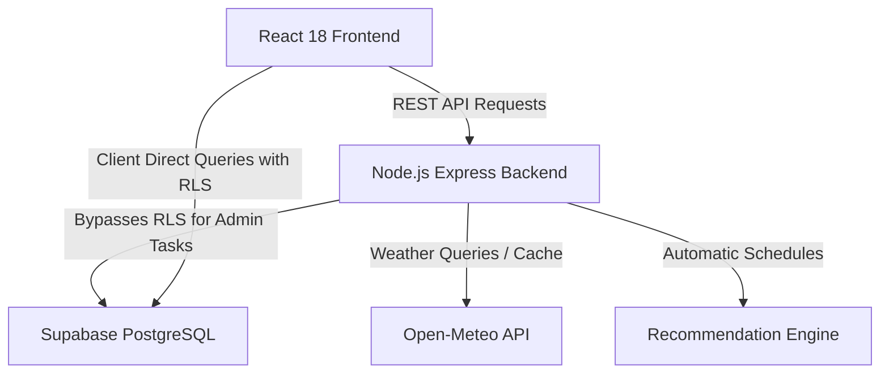
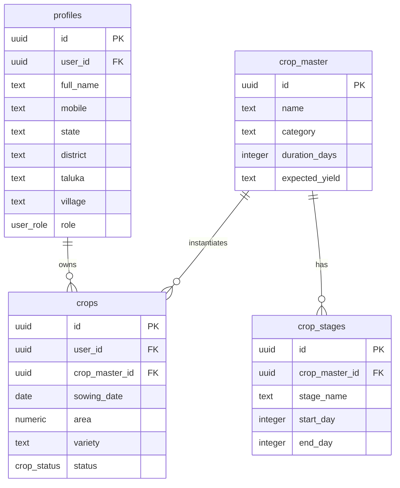

# Smart Krushi Mitra (स्मार्ट कृषी मित्र)

Your Smart Farming Companion — a complete Digital Farming Assistant platform that helps Indian farmers manage crops from sowing to harvesting.

---

## Architecture Diagram



---

## Database ER Diagram



---

## Setup & Running Guide

### Database Setup
1. Create a Supabase Project.
2. In the Supabase SQL Editor, copy and run the schema file: [01_schema.sql](file:///c:/Agrozone%20office/Smart%20krushi%20Mitra/supabase/database/migrations/01_schema.sql).
3. Populate database seeds by executing: [seed.sql](file:///c:/Agrozone%20office/Smart%20krushi%20Mitra/supabase/database/seed/seed.sql).

### Backend Setup
1. Navigate to `/backend`.
2. Copy `.env.example` to `.env` and fill in `SUPABASE_URL` and `SUPABASE_SERVICE_ROLE_KEY`.
3. Install dependencies:
   ```bash
   npm install
   ```
4. Run in development:
   ```bash
   npm run dev
   ```

### Frontend Setup
1. Navigate to `/frontend`.
2. Install dependencies:
   ```bash
   npm install
   ```
3. Run Vite server:
   ```bash
   npm run dev
   ```
4. Access app at `http://localhost:3000`.
